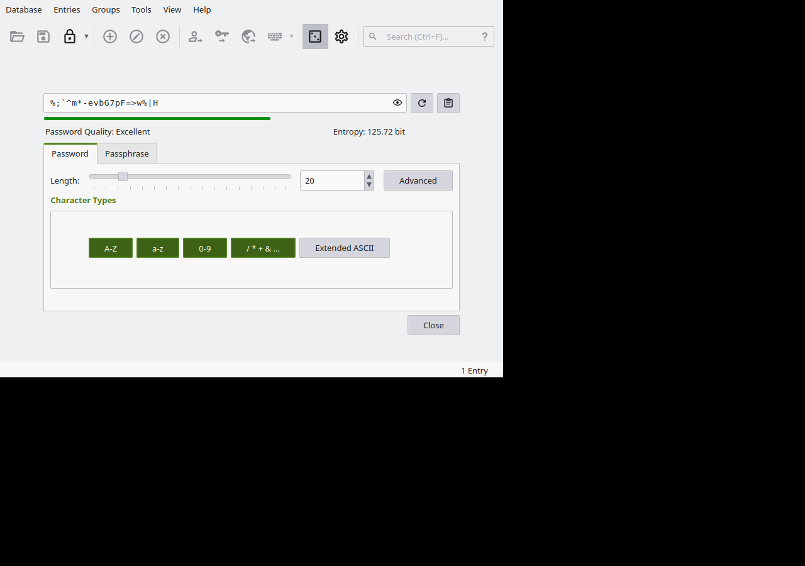
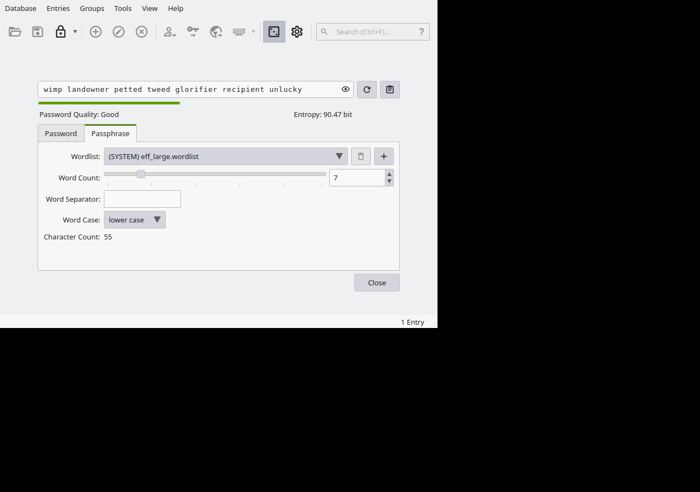

# The Password Generator

The generator is the reason to have a
password manager at all. If a human invents
a password, a computer can usually guess
the pattern; if the generator invents it,
there is no pattern. KeePassXC has **two**
generators, and choosing between them is
the only real decision:

- **Character passwords** — random letters,
  digits and symbols, like
  `aPttdkYdtsiCwtNM73bnrehJusspVXYW`. For
  pasting into websites, which is most of
  life with a password manager.
- **Passphrases** — random *words*, diceware
  style, like `wimp landowner petted tweed
  glorifier recipient unlucky`. For the few
  passwords you must type or memorise: the
  master password above all.

## In the window

**Tools → Password Generator** opens the
generator as its own view. The lab ran the
real one and photographed both tabs:



On the **Password** tab: the generated
password up top, its quality in words
("Excellent"), and its **entropy** — the
honest measure of guessability, in bits —
computed live: **125.72 bits** for the
20-character, all-character-classes
password on screen. Below are the length
slider and the character classes —
capitals, lowercase, digits, symbols —
each a toggle; the lab's shot has all but
Extended ASCII on).



On the **Passphrase** tab: the same readout
for words — **90.47 bits** for the 7-word
phrase on screen, drawn from the **EFF
large wordlist**, with word count, separator
and capitalisation controls.

The arithmetic behind that number is worth
seeing once: the EFF list holds 7,776
words, so each word chosen truly at random
carries about 12.9 bits (2¹²·⁹ ≈ 7,776).
Seven words ≈ 90 bits — the window's own
readout agrees. Ten words would be about
129. Bits add up linearly with words, which
is why "just add another word" is the whole
secret of passphrase strength.

## On the command line

`generate` prints a character password:

```console
$ keepassxc-cli generate
aPttdkYdtsiCwtNM73bnrehJusspVXYW
```

(The lab's bare run printed 32 characters
of letters and digits.) The flags shape it:
`-L` length, `-l`/`-U`/`-n`/`-s` for
lowercase, capitals, numbers, specials,
`--exclude-similar` to drop look-alikes
(`O`/`0`, `l`/`1`) for passwords a human
might have to read aloud, and `-c` to
supply your own character set:

```console
$ keepassxc-cli generate -L 16 -l -U -n -s
F,"5T['Fwn<`x-3"

$ keepassxc-cli generate -L 12 -c abcdef0123456789
05537d0f5258
```

`diceware` prints a passphrase:

```console
$ keepassxc-cli diceware
repaying abroad falcon chunk protozoan broom shell

$ keepassxc-cli diceware -W 4
emit acid ancient degrading
```

Default is 7 words (the `-W` count), space
separated, from the same EFF list the
window uses; `-W /path/to/wordlist` swaps
the list. Generating *into* an entry, so
nothing is ever typed or pasted, is chapter
5's `add -g` and `edit -g`.

## Rules of thumb that survive contact

- **A different password for every entry.**
  Generation makes this free; reuse is what
  turns one site's breach into all your
  accounts (chapter 7 counts it).
- **Length over cleverness.** For character
  passwords, 16–20 characters with all
  classes is comfortably beyond guessing;
  the window's entropy readout tells you
  the truth for any settings you pick.
- **Passphrases for the passwords in your
  head** — the master password first of
  all, then disk encryption and the like.
- **Let the machine keep the awkward ones.**
  You will paste, not type, 99% of what the
  generator makes. Awkward is fine.

Check: open the generator, set 7 words on
the Passphrase tab, and watch the entropy
sit near 90 bits; add a word and watch it
climb by about 13. That dial — words in,
bits out — is password strength with the
mystery removed.
