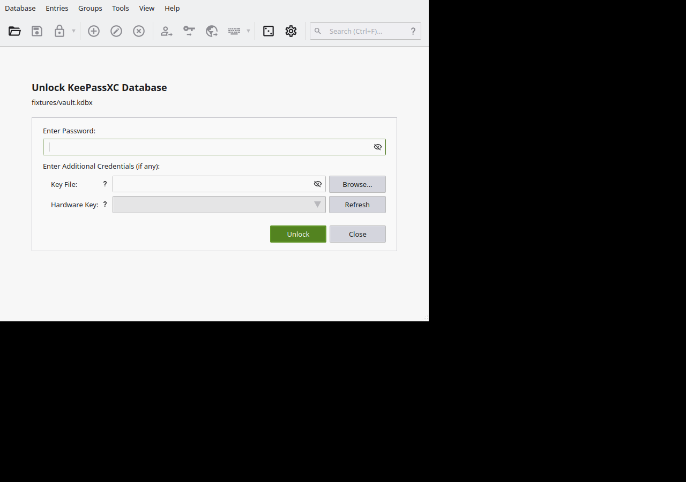
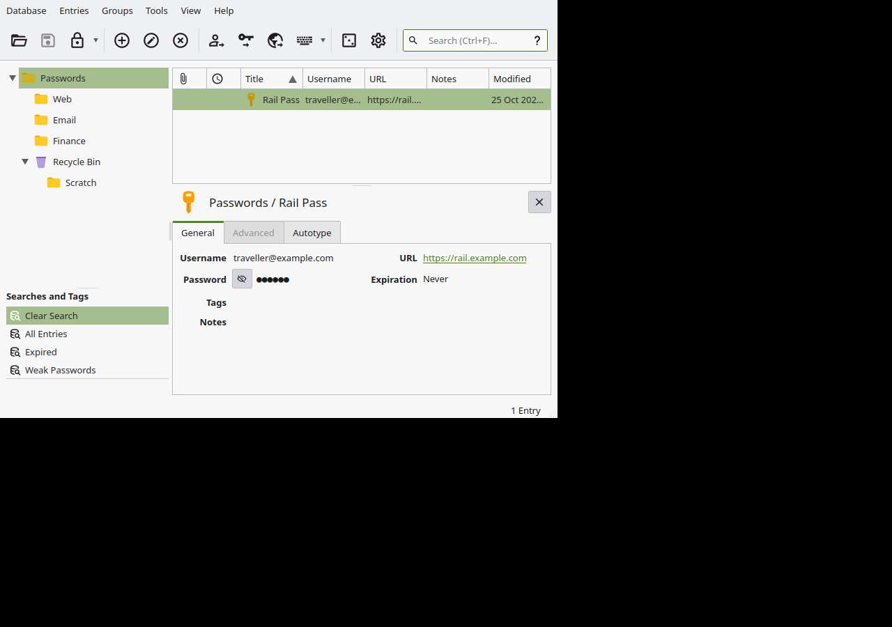

# Your First Database

A database is made once and opened forever
after. This chapter makes one, chooses its
master password properly, and tours the
window it opens into.

The lab's database was created on the
command line — the commands are below,
verbatim — and then opened in the real
window, which is where the chapter's
photographs come from. Creating one in the
window instead is **Database → New
Database…** (the menu item is real; the
lab read it in the window's own menu). The
wizard asks for a name, then credentials,
then where to save the file. The lab did
not click through that wizard, and chapter
10's criteria notes say so; everything
after the file exists, it did.

## Choosing the master password

This one password guards all the others,
so it plays by different rules:

- **Long beats clever.** A passphrase of
  five or more ordinary words — the kind
  chapter 6 generates — is both stronger
  and more typable than `Tr0ub4dor&3`-style
  inventions. The lab's *fixture* password
  is a three-word one, published in the
  transcripts on purpose; yours should be
  longer and published nowhere.
- **Unique.** It must not be a password
  used anywhere else. If it is, it is not a
  master password, it is a shared one.
- **Written down, physically, somewhere
  safe** — at least until it is burned into
  memory. There is no recovery (chapter
  13). A sealed envelope in a drawer beats
  a forgotten "unforgettable" password.

## Creating it on the command line

`db-create` asks for the new password
twice. Piped in, the whole thing is one
non-interactive step — the pattern every
script in this guide uses:

```console
$ printf 'demo-master-passphrase\ndemo-master-passphrase\n' \
    | keepassxc-cli db-create --set-password vault.kdbx
Enter password to encrypt database (optional): 
Repeat password: 
Successfully created new database.
```

(`--set-password` is the flag that says "a
password is one of the credentials". It has
a sibling, `--set-key-file`, in chapter 8.)

What landed on disk:

```console
$ ls -l vault.kdbx
-rw------- 1 root root 1118 Oct 25 02:18 vault.kdbx

$ keepassxc-cli db-info vault.kdbx
UUID: {63e95822-347e-4a37-bfcf-44c3f6139970}
Name: 
Description: 
Cipher: AES 256-bit
KDF: AES (1000000 rounds)
Recycle bin is enabled.
Location: vault.kdbx
...
Number of groups: 1
Number of entries: 0
```

(Trimmed; the full transcript is
`keepassxc-lab/transcripts/t01-create-and-db-info.txt`.)
Three details to carry forward: the file is
created readable only by its owner
(`-rw-------`); the one group it counts is
the root group, named **Passwords** — the
name at the head of every path in this
guide's exports; and `db-info` is the
health page you will meet again in chapter
7.

## Opening it in the window

Launch `keepassxc` with the file (or open
it from **Database → Open Database…**) and
you get the unlock screen:



Three fields matter here, and chapter 2
named them: the **password** (typed, with
an eye button to peek), the **Key File**
field, and the **Hardware Key** field. A
password-only database needs only the
first. Type it, press **Unlock**, and the
main window opens:



Anatomy, top to bottom:

- **Menus and toolbar**: Database, Entries,
  Groups, Tools, View, Help — everything in
  this guide is reachable from them.
- **The group tree** (left): your folders,
  under the root group "Passwords". Below
  it, **Searches and Tags** holds standing
  views — *All Entries*, *Expired*, and
  *Weak Passwords*, a list you will put to
  work in chapter 7.
- **The entry list** (centre): one row per
  entry in the selected group, with Title,
  Username, URL and Modified columns.
- **The preview pane** (below): the
  selected entry, its password shown as
  dots, with **General**, **Advanced** and
  **Autotype** tabs.
- **The search box** (top right): start
  typing and the list filters. Chapter 5.

This photograph is the lab's real database
— by then it held groups and entries and a
Recycle Bin, all added from the terminal
while the window was closed. The window
neither knows nor cares which program wrote
the file.

Check: your database file exists with
permissions only you can read; `db-info`
names its cipher and KDF; and the window
opens it with the password you chose.
Chapter 5 fills it.
